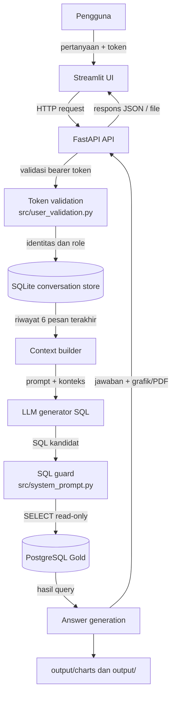
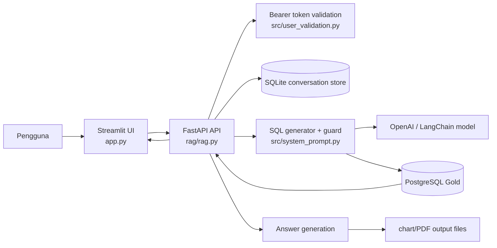
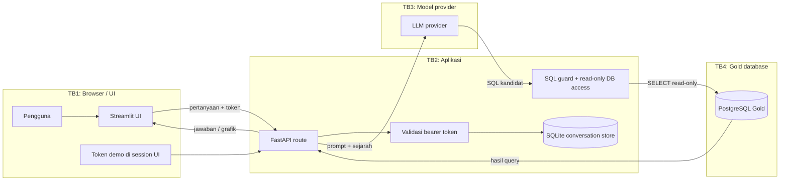

# Arsitektur Sistem Analytic Agent

Dokumen ini menjelaskan arsitektur yang benar-benar ada pada kode saat ini, bukan rancangan ideal. Fokusnya adalah jalur permintaan pengguna, validasi autentikasi, pembuatan SQL, eksekusi pada Gold database, dan batas kepercayaan data yang dilewati selama proses tersebut.

## 1. Ringkasan eksekutif

Aplikasi terdiri dari empat layer utama:

- Frontend: Streamlit di [app.py](../app.py)
- API: FastAPI di [rag/rag.py](../rag/rag.py)
- Validasi dan guard keamanan: [src/user_validation.py](../src/user_validation.py), [src/system_prompt.py](../src/system_prompt.py), [src/rbac.py](../src/rbac.py)
- Penyimpanan data dan akses analitik: SQLite untuk percakapan dan PostgreSQL Gold untuk query analitik

Aplikasi menerima pertanyaan dari pengguna, menyimpan riwayat percakapan milik pengguna di SQLite, meminta model untuk menghasilkan SQL yang aman, mengecek tabel dan kolom yang dibolehkan, mengeksekusi query dalam mode read-only, lalu mengirim hasil ke model penjawab. Hasil final bisa berbentuk teks, tabel, grafik, atau file PDF yang ditulis ke direktori lokal.

## 2. Diagram data flow

Diagram ini mencerminkan aliran aktual pada kode: pertanyaan masuk dari UI, diverifikasi oleh API, disimpan di SQLite untuk konteks percakapan, dikirim ke model untuk menghasilkan SQL, dieksekusi pada Gold dalam mode read-only, lalu hasilnya digunakan untuk menjawab pengguna dan menghasilkan artefak visual bila diperlukan.

## 3. Diagram arsitektur tinggi

## 4. Komponen utama

### 3.1 Frontend Streamlit

File: [app.py](../app.py)

- Menampilkan antarmuka penggunanya.
- Memilih token demo yang dikirim ke backend.
- Mengirim pertanyaan melalui `Authorization: Bearer <token>`.
- Menampilkan hasil percakapan, gambar grafik, dan output file bila ada.
- Tidak berhak mengakses Gold secara langsung; ia hanya berkomunikasi dengan API.

### 3.2 API FastAPI dan lifecycle aplikasi

File: [rag/rag.py](../rag/rag.py)

- Menjalankan `FastAPI` dengan `lifespan` untuk inisialisasi database dan layanan.
- Membuat tabel SQLite `conversations` dan `messages` bila belum ada.
- Menghubungkan ke PostgreSQL Gold pada startup, mengecek apakah tabel `gold.shipment_fact`, `gold.carrier_daily`, dan `gold.city_daily` sudah terisi.
- Memulai proses Streamlit tambahan dari dalam container API (`streamlit run app.py`).
- Menyediakan endpoint utama seperti chat/conversation, query, dan health check.
- Memastikan owner/conversation ID cocok dengan identitas pengguna saat membaca, mengirim, atau menghapus percakapan.

### 3.3 Autentikasi dan otorisasi demo

File: [src/user_validation.py](../src/user_validation.py)

- Menggunakan `HTTPBearer` untuk membaca token bearer.
- Memetakan token demo ke `username`, `role`, dan `layer` pada server.
- Memvalidasi role yang diizinkan sebelum endpoint analitik dapat dipanggil.
- Token tidak valid menghasilkan `401` dan role yang tidak diizinkan menghasilkan `403`.

Contoh role yang valid:

- `ops_logistik_kurir`
- `manajemen_executive`
- `customer_service`
- `marketing_campaign`
- `finance_anti_fraud`

### 3.4 Penyimpanan percakapan

Pada API, SQLite dipakai sebagai persistence conversation store.

- Tabel `conversations`: menyimpan `id`, `owner_id`, `title`, `created_at`, `updated_at`
- Tabel `messages`: menyimpan `conversation_id`, `role`, `content`, `chart_base64`, `created_at`
- Saat list/read/send/delete dipanggil, API membandingkan `owner_id` dari token terhadap `owner_id` conversation.
- Jika tidak cocok, API mengembalikan `404` untuk menjaga isolasi data antar pengguna.

### 3.5 Generator SQL dan guard keamanan

File: [src/system_prompt.py](../src/system_prompt.py)

- Menyediakan `ChatOpenAI` yang menghasilkan SQL dari pertanyaan natural-language.
- Menggunakan prompt sistem yang membatasi tabel yang diperbolehkan: `gold.shipment_fact`, `gold.carrier_daily`, dan `gold.city_daily`.
- Menolak keyword SQL berbahaya seperti `INSERT`, `UPDATE`, `DELETE`, `DROP`, `ALTER`, `COPY`, dan variasi lainnya.
- Memastikan satu statement SQL utama berbentuk `SELECT`.
- Menerapkan batas `LIMIT`, `timeout`, dan pembatasan tabel/kolom saat query diproses.
- Menjaga `exception_note` hanya dipakai bila user secara eksplisit meminta data tersebut.

### 3.6 RBAC dan akses kolom

File: [src/rbac.py](../src/rbac.py)

- Mendefinisikan `ROLE_COLUMNS` yang berisi kolom yang relevan per role.
- Ini berfungsi sebagai petunjuk keamanan dan pola akses per role, meski enforcement penuh terhadap kolom masih bersifat parsial di lapisan SQL guard.
- Role tidak menentukan data secara langsung pada client; autentikasi yang benar tetap dilakukan di server API.

### 3.7 Koneksi database Gold

File: [src/connect_to_db.py](../src/connect_to_db.py), [src/db_set.py](../src/db_set.py)

- Menghubungkan aplikasi ke PostgreSQL Gold dengan URL dari `RAG_DATABASE_URL` atau fallback `DATABASE_URL`.
- Menyiapkan dan mengisi data Gold bila tabel masih kosong.
- Query agent dijalankan pada koneksi yang dibatasi untuk read-only access sesuai best practice dalam proyek ini.

## 5. Alur request saat ini

1. Pengguna membuka UI Streamlit dan memilih/mengisi token demo.
2. UI mengirim pertanyaan ke FastAPI dengan header `Authorization: Bearer <token>`.
3. API memvalidasi token dan membandingkan user/role yang diizinkan.
4. API mengambil history 6 pesan terakhir dari SQLite untuk konteks follow-up.
5. Model diarahkan untuk menghasilkan SQL yang relevan terhadap Gold.
6. SQL guard memeriksa statement, tabel, keyword, dan batas keamanan sebelum eksekusi.
7. Query dijalankan terhadap PostgreSQL Gold dengan mode read-only dan timeout terbatas.
8. Hasil query, termasuk `exception_note` bila diminta, dikirim ke model teks untuk menjawab.
9. Jawaban final dan gambar grafik/PDF disimpan di SQLite dan file lokal.
10. API mengembalikan respons ke UI untuk ditampilkan.

## 6. Diagram trust boundary

### Penjelasan boundary

- TB1 sampai TB2: token demo berada di client dan dikirim ke server. Validasi akhir dilakukan di server, bukan di browser.
- TB2 sampai TB3: pertanyaan, konteks, schema, dan hasil query dikirim ke provider model. Semua input pengguna dan data database harus dianggap tidak tepercaya.
- TB2 sampai TB4: query dieksekusi hanya pada tabel Gold yang diizinkan, dengan batas read-only dan timeout.
- SQLite hanya menyimpan percakapan milik pengguna; itu bukan sumber kebenaran analitik.

## 7. Risiko dan celah yang diketahui

- Token demo statis di kode bukan autentikasi produksi; ini hanya simulasi untuk demo.
- Validasi SQL masih berbasis prompt dan pemeriksaan string; belum sepenuhnya menggantikan validator AST/kolom yang deterministik.
- Beberapa endpoint seperti `/healthz` dan `/ask-rag` tidak menerapkan autentikasi yang sama dengan route utama.
- API lifecycle memulai proses Streamlit tambahan di dalam container API; ini bukan pola deployment yang ideal.
- Server masih bergantung pada environment variable `RAG_DATABASE_URL` / `DATABASE_URL`; konsistensi konfigurasi harus dijaga agar tidak mengarah ke database yang berbeda dari setup aplikasi.
- Role dan allowlist kolom perlu diperkuat secara konsisten agar setiap role hanya melihat kolom yang benar-benar dibutuhkan.

## 8. Keputusan arsitektural penting

- Data analitik yang valid berasal dari Gold database, bukan dari hasil model atau cache lokal.
- SQLite hanya menyimpan percakapan dan metadata pengguna, bukan fakta bisnis.
- Pertanyaan yang tidak berhubungan dengan analitik pengiriman harus ditolak/ditangani secara eksplisit.
- Prompt injection harus diperlakukan sebagai ancaman: teks database seperti `exception_note` tidak boleh mengubah instruksi model atau membukakan akses ke operasi berbahaya.
- Query harus dibatasi pada tabel `gold.shipment_fact`, `gold.carrier_daily`, dan `gold.city_daily` sesuai kontrak dataset.

## 9. Referensi kode

- [app.py](../app.py)
- [rag/rag.py](../rag/rag.py)
- [src/system_prompt.py](../src/system_prompt.py)
- [src/user_validation.py](../src/user_validation.py)
- [src/rbac.py](../src/rbac.py)
- [src/connect_to_db.py](../src/connect_to_db.py)
- [src/db_set.py](../src/db_set.py)
- [compose.yaml](../compose.yaml)
